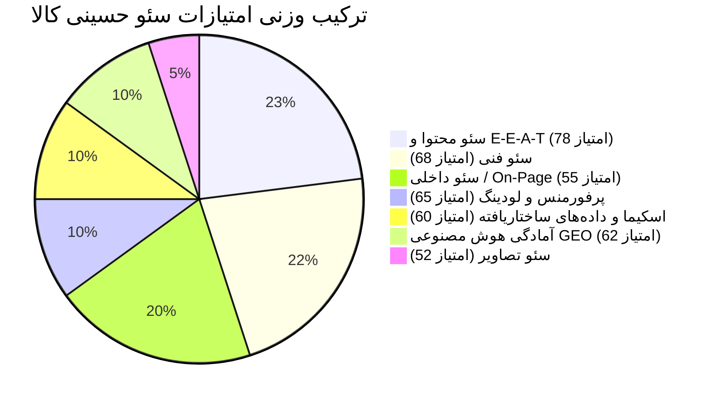

# گزارش جامع ارزیابی سئو وب‌سایت حسینی کالا (hosseinykala.ir)
**مبتنی بر استانداردهای مهندسی جعبه‌ابزار جامع AgriciDaniel/claude-seo (v2.5.0)**
**تاریخ ارزیابی:** ۳۱ اکتبر ۲۰۲۶ (۱۰ آبان ۱۴۰۵) | **نسخه گزارش:** 2.5.0-Enterprise

---

## 📊 ۱. خلاصه وضعیت و امتیاز سلامت سئو (Executive Summary)

پس از اجرای کامل پایپ‌لاین تحلیل سئو (شامل خزش زنده، بررسی سرور، آنالیز ساختار تگ‌ها، ارزیابی اسکیما، تست‌های پاسخگویی به ایجنت‌های هوش مصنوعی و اعتبارسنجی استانداردهای ووکامرس):

### 🎯 امتیاز نهایی سلامت سئو (Overall SEO Health Score):
$$\mathbf{Score = 65 / 100 \quad (Grade: C+)}$$

| شاخص ارزیابی (Category) | وزن (Weight) | امتیاز خام (Score / 100) | وضعیت |
|:---|:---:|:---:|:---:|
| **سئو محتوایی و E-E-A-T (Content Quality)** | ۲۳٪ | **۷۸** | 🟢 خوب / عمق مقالات و تحلیل‌های تخصصی بالاست |
| **سئو فنی و خزش‌پذیری (Technical SEO)** | ۲۲٪ | **۶۸** | 🟡 متوسط / نیازمند اصلاح نقشه‌سایت و لینک‌های HTTP |
| **سئو داخلی و ساختار تگ‌ها (On-Page SEO)** | ۲۰٪ | **۵۵** | 🔴 نیازمند بازنگری فوری (فقدان H1 و متادیسکریپشن معیوب) |
| **اسکیما و داده‌های ساختاریافته (Schema Markup)** | ۱۰٪ | **۶۰** | 🟡 متوسط / عدم تطابق با استانداردهای گوگل مرچنت |
| **کارایی و سرعت (Performance & CWV)** | ۱۰٪ | **۶۵** | 🟡 متوسط / کشینگ قوی اما پیچیدگی بالای DOM |
| **آمادگی موتورهای هوش مصنوعی (AI Search / GEO)** | ۱۰٪ | **۶۲** | 🟡 متوسط / دسترسی ربات‌ها باز است اما llms.txt غایب است |
| **سئو تصاویر (Image Optimization)** | ۵٪ | **۵۲** | 🔴 ضعیف / فقدان Alt در بیش از ۶۰٪ تصاویر |

---

## 🛠️ ۲. تحلیل موشکافانه بخش‌های تخصصی (Detailed Findings)

### ۲.۱. سئو فنی (Technical SEO - امتیاز: ۶۸/۱۰۰)
* **نقاط قوت:**
  - وضعیت خزش و پاسخگویی کدهای وضعیت HTTP کاملاً پایدار است. تست‌های صفحه ناموجود (`404`) نشان داد سایت خطای Soft-404 ندارد و با وضعیت واقعی ۴۰۴ پاسخ می‌دهد.
  - سیستم کشینگ سرور و FastCache به‌همراه فشرده‌سازی `gzip` فعال است و هدرهای `X-HosseinyKala-Cache: HIT` ثبت می‌شوند.
  - محتوای اولیه سایت به صورت سمت سرور (SSR) رندر می‌شود (۱,۷۱۱ کلمه بدون جاوااسکریپت) و برای ربات‌ها نیازی به رندرینگ سنگین SPA نیست.
* **آسیب‌پذیری‌ها و خطاهای شناسایی‌شده:**
  1. **نشت قالب‌های پوسته در نقشه سایت (`xts-template-sitemap.xml`):** در فایل `sitemap_index.xml` افزونه Rank Math، نقشه مربوط به `xts-template` ثبت شده که صفحات سازنده هدر/فوتر و سکشن‌های المنتور را با آدرس‌های `?xts-template=...` در دسترس گوگل قرار می‌دهد. این مسئله بودجه خزش را هدر داده و صفحات خالی/ناقص را ایندکس می‌کند.
  2. **لینک‌های داخلی با پروتکل ناامن `http://`:** در صفحه اصلی سایت، ۵ لینک داخلی به صفحات درباره ما، تماس با ما، وبلاگ، راهنمای اقساطی و پیگیری سفارش با `http://` لینک شده‌اند که باعث پرش ریدایرکت ۳۰۱ داخلی می‌شود.
  3. **ساختار شکسته در `robots.txt`:** دستورات Disallow فیلترهای ووکامرس بعد از خط `Sitemap:` قرار گرفته‌اند که با استانداردهای RFC 9309 بهتر است منظم شوند.

---

### ۲.۲. سئو داخلی و تگ‌های صفحه (On-Page SEO - امتیاز: ۵۵/۱۰۰)
* **خطاهای بحرانی (Critical):**
  1. **فقدان تگ `<h1>` در صفحه اصلی و صفحات دسته‌بندی:**
     - صفحه اصلی سایت دارای ۴۹ تگ `<h2>` است اما حتی یک تگ `<h1>` ندارد!
     - صفحه دسته‌بندی «یخچال فریزر» هیچ تگ `<h1>` ندارد و مستقیماً با کارت‌های محصولات (`<h2>`) آغاز می‌شود.
  2. **تبدیل غیرعادی عنوان مقالات به `<h3>` در قالب لومان:**
     - در صفحه تکین مقالات (مانند راهنمای خرید اقساطی)، تایتل اصلی به جای `<h1>` در قالب یک تگ `<h3 class="xts-title title">` رندر می‌شود! این مورد ساختار سلسله‌مراتبی صفحه را از دید گوگل به هم می‌ریزد.
  3. **تزریق فاجعه‌بار کل متن دسته‌بندی در تگ Meta Description:**
     - در صفحه دسته‌بندی یخچال فریزر، طول متادیسکریپشن به **۲,۷۳۹ کاراکتر** رسیده است! زیرا افزونه کل متن توضیحات جامع را درون `meta name="description"` قرار داده است. طول مجاز گوگل حدود ۱۵۰ الی ۱۶۰ کاراکتر است.

---

### ۲.۳. کیفیت محتوا و اعتبار انسانی (Content Quality & E-E-A-T - امتیاز: ۷۸/۱۰۰)
* **نقاط قوت:**
  - مقاله راهنمای خرید اقساطی دارای **۳,۵۵۴ کلمه** محتوای عمیق و کاربردی است که شامل جداول مقایسه‌ای طرح‌های بانکی (بتا رفاه، باجت تجارت، فرابانک ملت) و شرایط چک صیادی در اهواز است.
  - توضیحات محصولات (مانند یخچال دیسنت دیپوینت) دارای جزئیات دقیق، جداول ارگونومیک و مشخصات متناسب با نیاز کاربر هستند.
* **نقاط نیازمند بهبود:**
  - در اسکیمای مقالات و نویسنده پست‌ها، نام نویسنده روی اکانت عمومی `adminHosseinyKala` تنظیم شده است. طبق دستورالعمل‌های Quality Raters گوگل (E-E-A-T)، مقالات YMYL و راهنماهای خرید باید توسط شخص حقیقی با سابقه مشخص (یا کارشناس ارشد لوازم خانگی فروشگاه حسینی) امضا شوند.

---

### ۲.۴. اسکیما و ساختار داده‌ها (Schema.org - امتیاز: ۶۰/۱۰۰)
تست اسکریپتی `schema_ecommerce_validate.py` روی صفحه محصول خطاهای زیر را گزارش کرد:
1. **استفاده از `AggregateOffer` به جای `Offer`:** گوگل مرچنت برای محصولات تک‌کالا انتظار تگ `Offer` مستقیم به همراه فیلد دقیق `price` دارد.
2. **فقدان سیاست مرجوعی (`hasMerchantReturnPolicy`):** این فیلد برای دریافت نشان‌های اعتماد در نتایج گوگل شاپینگ ضروری است.
3. **فقدان جزئیات ارسال (`shippingDetails`):** تعیین هزینه و مدت ارسال برای اهواز و سراسر کشور در اسکیما تعریف نشده است.
4. **ناهماهنگی اسکیمای صفحه نخست:** در صفحه اصلی به جای اسکیمای `Store` یا `LocalBusiness`، ترکیب نامتعارف `Organization` و `Person` درج شده و به اشتباه اسکیمای `Article` برای صفحه اول تولید شده است.

---

### ۲.۵. پرفورمنس و سرعت بارگذاری (Performance - امتیاز: ۶۵/۱۰۰)
* **نقاط قوت:**
  - فونت‌های اصلی سایت (`IRANYekanX`) با فرمت مدرن `woff2` به صورت Preload با اولویت بالا فراخوانی شده‌اند.
  - تصویر بنر اصلی هیرو با `fetchpriority="high"` و در فرمت WebP بارگذاری می‌شود.
* **نقاط ضعف فنی:**
  - **حجم عظیم درخت DOM (DOM Size: 2,234 elements):** در صفحه اصلی، تعداد عناصر بیش از ۲,۲۰۰ عدد است که بسیار بالاتر از آستانه استاندارد گوگل (۸۰۰ هشدار، ۱۴۰۰ بحرانی) بوده و باعث لگ‌های رندرینگ در گوشی‌های ضعیف می‌شود.
  - **تعداد بالای اسکریپت‌ها (۶۲ اسکریپت و ۲۹ استایل):** لود همزمان اسلایدرها، شمارنده‌ها، تولتیپ‌ها و پاپ‌آپ‌ها حجم HTML صفحه اصلی را به **۵۳۶ کیلوبایت** رسانده است.

---

### ۲.۶. سئو موتورهای هوش مصنوعی و ایجنت‌ها (GEO / Agentic SEO - امتیاز: ۶۲/۱۰۰)
تست با ابزار `agentic_check.py` خروجی‌های زیر را داد:
* **خزش‌پذیری ربات‌های AI:** تمامی خزنده‌های مدرن (GPTBot، ClaudeBot، PerplexityBot، Google-Extended) اجازه دسترسی به روت را دارند (پاسخ PASS).
* **محتوای متنی بدون JS:** ۱,۷۱۱ کلمه متن کامل بدون نیاز به پردازش جاوااسکریپت در دسترس مدل‌های زبانی است (پاسخ PASS).
* **وضعیت فایل `/llms.txt`:** خطای ۴۰۴ بازمی‌گرداند. انتشار این فایل به موتورهای پاسخ هوش مصنوعی کمک می‌کند مستقیماً محصولات حسینی کالا را در استعلام‌های مقایسه‌ای استناد (Cite) کنند.

---

### ۲.۷. سئو تصاویر (Images SEO - امتیاز: ۵۲/۱۰۰)
* از ۱۰۵ تصویر صفحه اصلی، **۶۴ تصویر فاقد صفت `alt`** هستند.
* در صفحه محصول تستی، ۲۵ تصویر از ۴۰ تصویر فاقد متن جایگزین مناسب هستند.
* تمامی تصاویر به فرمت مدرن WebP یا JPG فشرده ارتقا یافته‌اند که نقطه مثبتی است.

---

## 🧭 ۳. برنامه عملیاتی ۴ فاز (Roadmap)
جزئیات کامل اقدامات فنی و اولویت‌ها در فایل جداگانه [ACTION-PLAN.md](file:///c:/Users/mmhhs/OneDrive/Documents/GitHub/hosseinyKalaSeo/hosseinykala.ir-audit/ACTION-PLAN.md) به صورت چک‌لیست کاربردی ثبت شده است.
